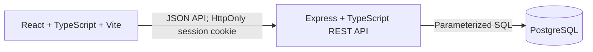

# DevTrack

**A focused workspace for turning team plans into visible project progress.**

DevTrack is a full-stack project and task management app. It brings teams, projects, and a Kanban task board into one workspace, with progress and workload metrics calculated from PostgreSQL records.

> **Elevator pitch:** DevTrack gives small teams one place to organize projects, assign work, and see what is moving or blocked.

## Features

- Account registration, login, session restoration, and logout.
- HttpOnly cookie-based browser sessions with origin checks on cookie-authenticated mutations.
- Workspaces with owner, admin, and member roles.
- Projects with manager/member access, project membership, and archive support.
- Task creation, editing, assignment, deletion, search, filters, and drag-and-drop status updates.
- Dashboard metrics, project progress, task status/priority breakdowns, and recent task comments from PostgreSQL.
- Safe, repeatable development seed data.
- PostgreSQL migrations, API validation, Docker Compose, and GitHub Actions CI.

## Screenshots and demo

- Dashboard: **TODO — add a current screenshot**
- Project list: **TODO — add a current screenshot**
- Kanban board: **TODO — add a current screenshot**
- Live demo: **Not currently hosted**

Do not treat the development demo account below as a production account.

## Architecture



In the Docker setup, Nginx serves the frontend and proxies `/api` requests to the Express service. PostgreSQL data is stored in a named Docker volume.

## Technology

| Area | Technology | Purpose |
| --- | --- | --- |
| Frontend | React, TypeScript, Vite | Component-based UI, static typing, and local development/build tooling |
| Styling | Tailwind CSS | Utility-based responsive styling |
| API | Node.js, Express, TypeScript | REST endpoints and server-side authorization |
| Validation | Zod | Runtime validation of environment variables and API input |
| Authentication | bcryptjs, JSON Web Tokens, HttpOnly cookies | Password hashing and expiring browser sessions |
| Database | PostgreSQL | Relational storage for users, teams, projects, tasks, and comments |
| Tests | Vitest, Supertest | Backend API and database integration tests |
| Runtime | Docker Compose, Nginx | Local multi-service runtime and frontend/API routing |

## Requirements

- Node.js 22 or later and npm.
- PostgreSQL 18, either installed locally or provided by Docker Compose.
- Docker Desktop with Docker Compose for the containerized setup.

## Run locally

1. Clone the repository:

   ```sh
   git clone <repository-url>
   cd devtrack
   ```

2. Create a local environment file:

   ```sh
   # macOS/Linux
   cp .env.example .env
   ```

   ```powershell
   # PowerShell
   Copy-Item .env.example .env
   ```

   Set a local PostgreSQL password and a random `JWT_SECRET` of at least 32 characters. Keep `.env` private and untracked.

3. Start the local PostgreSQL service:

   ```sh
   docker compose up -d postgres
   ```

   Alternatively, configure `.env` to connect to an existing PostgreSQL database.

4. Install dependencies and apply migrations:

   ```sh
   npm --prefix server ci
   npm --prefix client ci
   npm --prefix server run db:migrate
   ```

5. Optionally add development demo data. The seed command is additive and idempotent; it does not truncate or drop data. It refuses to run in production. Supply the demo password only to this command:

   macOS/Linux:

   ```sh
   DEVTRACK_DEMO_PASSWORD='DevTrack@123' npm --prefix server run db:seed
   ```

   PowerShell:

   ```powershell
   $env:DEVTRACK_DEMO_PASSWORD = 'DevTrack@123'
   npm --prefix server run db:seed
   Remove-Item Env:\DEVTRACK_DEMO_PASSWORD
   ```

6. Start the API and frontend in separate terminals:

   ```sh
   npm --prefix server run dev
   npm --prefix client run dev
   ```

   Open <http://localhost:5173>. The API runs on port `5000`; its liveness and readiness endpoints are `/health` and `/health/ready`.

### Development-only demo login

- Email: `demo@devtrack.local`
- Password: `DevTrack@123`

These credentials are for local development and demonstrations only. Do not configure this account or password in production.

## Run with Docker Compose

1. Copy `.env.example` to `.env`, set `DB_PASSWORD`, and replace `JWT_SECRET` with a random value of at least 32 characters.
2. For local HTTP Compose, keep `COOKIE_SECURE=false`. For any HTTPS production deployment, set `COOKIE_SECURE=true` and terminate TLS at a trusted reverse proxy.
3. Build and start:

   ```sh
   docker compose up --build
   ```

Compose starts PostgreSQL, applies pending migrations, starts the API, and serves the frontend through Nginx. Open <http://localhost:8080>. The API readiness check is available at <http://localhost:5000/health/ready>.

Compose does **not** seed demo records automatically. To create them in a local development database, use the `db:seed` command above from the host with the local `.env` configured. The seed command rejects `NODE_ENV=production`.

## Environment variables

Backend values are defined by `.env.example` and backend environment validation. `VITE_API_URL` is read by Vite from `client/.env`; see `client/.env.example`. For Compose, `COMPOSE_CLIENT_URL` sets the browser origin accepted by the API. Do not put real secrets in tracked files.

| Variable | Purpose | Local default / requirement |
| --- | --- | --- |
| `NODE_ENV` | Runtime environment | `development` |
| `PORT` | API listening port | `5000` |
| `DB_HOST` | PostgreSQL hostname | `localhost` locally; `postgres` in Compose |
| `DB_PORT` | PostgreSQL port | `5432` |
| `DB_NAME` | Application database | Required |
| `DB_USER` | Database user | Required |
| `DB_PASSWORD` | Database password | Required |
| `JWT_SECRET` | JWT signing secret | Required; at least 32 characters |
| `JWT_EXPIRES_IN` | Session token lifetime | `1d` |
| `COOKIE_SECURE` | Add the Secure cookie attribute | `false` for local HTTP; **must be `true` behind production HTTPS** |
| `CLIENT_URL` | Allowed frontend origin | `http://localhost:5173` locally |
| `COMPOSE_CLIENT_URL` | Frontend origin allowed by the Compose API | `http://localhost:8080` |
| `VITE_API_URL` | Frontend API base URL in `client/.env` | `http://localhost:5000/api`; Compose uses `/api` |
| `DEVTRACK_DEMO_PASSWORD` | Password supplied to the seed command | Required only when running `db:seed` |

Set `VITE_API_URL` in `client/.env` only when overriding the local API base URL; Compose configures the frontend to use `/api`.

The browser session cookie is HttpOnly, SameSite Strict, scoped to `/api`, and expires with its JWT. Cookie-authenticated mutations require the configured frontend origin. Login and registration do not expose a token in the JSON response. A bearer token from an older DevTrack version can be exchanged for a cookie by calling `/api/auth/me`; new browser sessions use cookies.

## Database and seed data

- SQL migrations are in `database/migrations`.
- Run local migrations with `npm --prefix server run db:migrate`.
- The seed script creates/reuses 9 development users, 3 teams, 5 projects, 45 tasks, and task comments.
- Test cleanup is restricted to the database named `devtrack_test`. Never point test configuration at an application or production database.
- The schema has no dedicated notifications, activity-log, labels, attachments, milestones, or project start/due-date tables. Those are not represented as seeded records.

## Tests and production builds

Create `.env.test` from `.env.example`, configure a separate local database with `DB_NAME=devtrack_test`, then apply its migrations and run backend tests:

```sh
npm --prefix server run db:migrate:test
npm --prefix server test
```

The test setup refuses to clean any database other than `devtrack_test`.

Run lint and production builds:

```sh
npm --prefix client run lint
npm --prefix client run build
npm --prefix server run lint
npm --prefix server run build
```

The CI workflow runs frontend/backend lint and builds, applies migrations to an isolated PostgreSQL test service, and runs backend tests.

## Current limitations

- No hosted demo or real screenshots have been published yet.
- There is no notification system, dedicated activity-log model, or profile-editing UI.
- Comments have API support and appear in dashboard recent activity; there is no in-task comment editor.
- Project detail API support exists, but the UI is organized around the project list and task board rather than a dedicated project-detail page.
- There is no production cloud deployment configuration.
- **License selection is pending.** See `LICENSE`; no license has been granted.

## Contributing and support

Read [CONTRIBUTING.md](./CONTRIBUTING.md) before opening a change. Please report security issues privately as described in [SECURITY.md](./SECURITY.md). For usage questions and bug reports, see [SUPPORT.md](./SUPPORT.md) and the GitHub issue templates.

## License

No open-source license has been selected. The placeholder `LICENSE` file is not a license grant. The repository owner must choose and add a license before publishing DevTrack for reuse.
